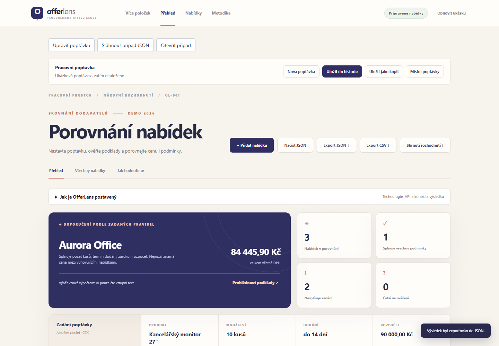

# OfferLens

**Porovnání dodavatelských nabídek s doloženými údaji, kontrolou člověka a přesným výpočtem.** Jedna položka s volitelnou AI extrakcí nebo celá vícepoložková poptávka s ruční kontrolou každého řádku.

[](https://github.com/OmegaCatt/offerlens/actions/workflows/ci.yml) · [Zaznamenaná ukázka](https://omegacatt.github.io/datadesk/portfolio/) (statický snímek, nikoli živý server)



## Jak se používá

1. Upravte produkt, počet, termín, záruku a rozpočet. Připravené fiktivní nabídky ukazují, proč nejlevnější kus nemusí znamenat nejvhodnějšího dodavatele.
2. Vložte text nabídky nebo místně načtěte textové PDF. Volitelná OpenAI extrakce předvyplní údaje s doslovnými úryvky; bez API je vyplníte ručně. Kliknutí na úryvek zvýrazní místo v originálu a uvede stranu PDF.
3. Porovnejte rozhodující pole s podkladem a potvrďte shodu výrobku. Chybějící doprava, DPH nebo neověřená hodnota brání doporučení. AI nepočítá výslednou cenu a neschvaluje nákup.
4. Vyhodnocení používá haléře a BigInt mezivýpočet DPH, kontroluje termín/záruku/počet a rozpočet. Teprve úplné vyhovující nabídky se řadí podle ceny včetně dopravy a DPH.
5. Uložte místní verzi s důvodem, porovnejte změny nebo přeneste aktuální případ přes JSON. Jednořádkové srovnání exportuje i CSV a Markdown podklad k rozhodnutí. Obnovení vždy ruší stará lidská potvrzení.

## Více položek

Odkaz **Více položek** otevře basket.html. Do 20 řádků poptávky a 30 dodavatelů: každá nabízená položka má vlastní cenu, DPH, skutečně dostupné množství, termín a záruku. Řádky se párují výslovným ID zadání a potvrzením shody, nikoli podobností názvu. Doprava se přičítá právě jednou za dodavatele. Chybějící, duplicitní, cizí nebo částečná položka zabrání doporučení celé dodávky.

Košík se vyplňuje a ověřuje **ručně**; neposkytuje víceřádkovou AI extrakci ani automatické kombinování nákupu mezi dodavatele. CZK. Má vlastní JSON a oddělenou historii, takže nepřepisuje jednořádkové případy. Před prací s dodavateli potvrďte upravené zadání; neuložený formulář se tiše nezamění za použité podmínky.

## Uložení a historie

IndexedDB ukládá jen na výslovný pokyn, nejvýše 20 případů / 10 posledních verzí / 10 MB v každém ze dvou oddělených úložišť. Jednořádkové případy mají rozdíly polí/zadání/citací, oba režimy umí otevřít zachovanou verzi a uložit další nebo kopii. Kontrola verze a zápis jsou v jedné atomické transakci; stará karta nepřepíše novější stav.

JSON přenáší **aktuální stav, nikoli celou historii**. Import ani obnovení nedůvěřují starým součtům, doporučení nebo kontrolním příznakům. Historie není sdílený ani podepsaný audit, neověřuje identitu a nepředstavuje nákupní schválení. Jiný browser profil/adresa nebo vymazání dat mohou uloženou historii znepřístupnit. Server nabídky ani historii neukládá.

## Technologie, API a PDF

HTML/CSS, JavaScript ES modules, Node.js 24 HTTP server, IndexedDB, vestavěný node:test. OpenAI Responses API se striktním JSON schématem pouze vytěžuje jeden vložený text. Runtime vyžaduje doslovný zdroj pro neprázdná pole; chybějící podklady odstraní. Výskyt citátu není důkaz správného významu. Konzervativní kontroly konkrétních rozporů cen nenahrazují úplné sémantické ověření.

PDF čte samostatný **Python 3.13+ / pypdf 6.21.4** proces bez proměnných OPENAI_*. Limit 15 sekund, 2 MB, 50 stran, omezené dekódování a nejvýše 8 000 znaků výstupu bez tichého zkrácení. Zachovávají se strany; originální binární soubor se neukládá. Sken vyžaduje OCR, šifrované PDF se odmítá. Nečte webové URL. Import PDF sám nevolá AI; uživatel ji spustí zvlášť.

Klíč čte pouze místní server z prostředí nebo ignorovaného .env.local podle .env.example. **Nikdy nepatří na GitHub ani do prohlížeče.** K AI se odešle vložený text, store:false. Limit dvě souběžné extrakce a 20 volání za 24 hodin běžícího procesu; restart procesový limit resetuje. PDF má vlastní dva sloty. Kontrola Host/Origin, omezená těla (50 000 bajtů pro text do 8 000 znaků), CSP a statické soubory pouze z web/. Bez autentizace: nevystavovat tento server veřejně s klíčem nebo skutečnými nabídkami.

## Spuštění a ověření

```powershell
node server.mjs
# Pro PDF navíc:
python -m pip install -r requirements.txt
```

[127.0.0.1:4174](http://127.0.0.1:4174); volitelně OFFERLENS_PYTHON určuje Python. Bez PDF běhové balíčky nejsou potřeba. Bez klíče fungují připravené nabídky, ruční zadání, historie a výpočty.

```powershell
python -m pip install -r requirements-dev.txt
pnpm install --frozen-lockfile
pnpm exec playwright install chromium
pnpm test
pnpm check
pnpm qa
```

34 automatických testů a obě browser sady: skutečné PDF, zvýraznění, místní historie a transakční konflikt, pravidla košíku, zrušení kontroly po importu/obnově, pozdní odpovědi, exporty a desktop/mobil. CI bez živých AI volání prošlo pro [d1ecd8b](https://github.com/OmegaCatt/offerlens/actions/runs/42729981429). Detaily a benchmark místní historie: [QA](docs/QA.md).

[Evaluace](evaluation/README.md): 12 obtížných fiktivních nabídek a 74 očekávaných polí. Skutečné běhy 71/74 a 73/74, původní reporty zachované, nalezené záměny cen mají regresní opravy. Dodatečná oprava po druhém běhu byla ověřena offline; není vydávaná za nové živé měření. Nejde o obecnou přesnost AI.

## Zavedení do firmy

Začít schválenými anonymizovanými nabídkami a vlastníkem nákupních pravidel. Ověřit režim DPH a zaokrouhlení konkrétního procesu, pravidla souhlasů s externí AI a reprezentativní extrakční sadu. Pro sdílenou práci přidat účty, oprávnění, serverovou historii, retenci, zálohy, trvalé limity a skutečný schvalovací proces. Dodavatelské/nákupní konektory, OCR a další měny jsou další rozšíření, nikoli implementovaná integrace.

## English

OfferLens compares fictional supplier quotes with optional **single-product** OpenAI extraction, verbatim evidence, clickable source highlighting and mandatory human verification. Deterministic integer/BigInt calculations handle VAT and shipping. Text PDFs are read by a bounded local Python/pypdf worker, with page labels; no OCR or URL scraping.

A separate multi-item basket supports explicit request-line IDs, per-line quantities/prices/terms, partial-supply blocking and shipping exactly once per supplier. Basket lines are entered/reviewed manually; no multi-line AI extraction or split-supplier optimization. CZK only.

Each workspace has separate bounded IndexedDB history with atomic optimistic conflict checks. Imported/restored reviews never authorize recommendations; JSON transfers current state, not the full archive. No authenticated approvals or shared database. Keys remain server-side. Run node server.mjs; PDF requires requirements.txt. 34 tests and two browser suites pass; two preserved live extraction runs score 71/74 and 73/74 expected fields on a small curated set, not general accuracy. Company adoption needs access controls, privacy approval, durable limits and a target-specific procurement process.
