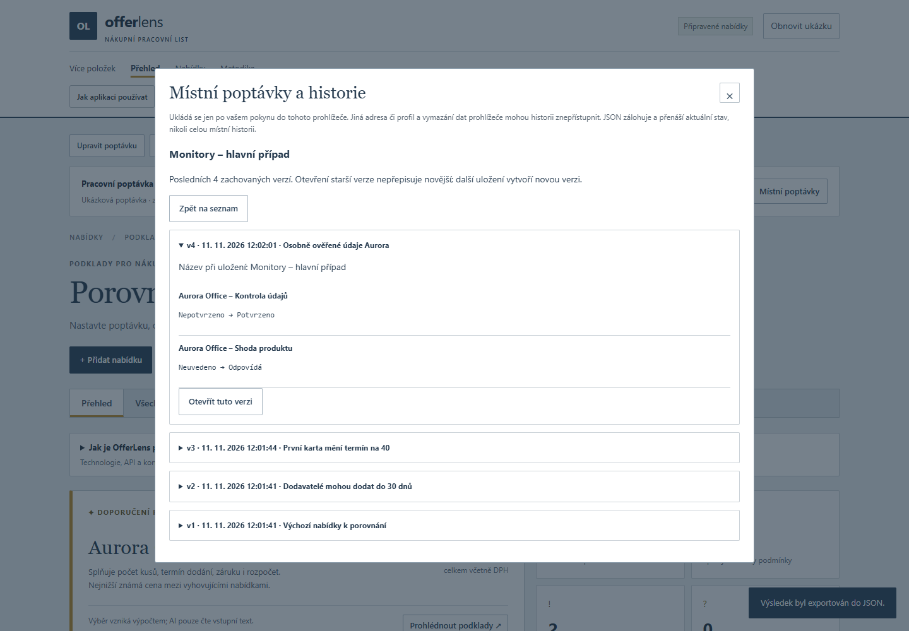

# Etapa 10. 11. 2026 – OL-3/4/5

**Nově textové PDF, vícepoložková poptávka a doložená extrakční evaluace.** Navigace „Více položek“ otevírá basket.html: vlastní zadání do 20 položek, 30 dodavatelů, cena/DPH/množství/termín/záruka po řádcích, doprava právě jednou. Částečné, duplicitní a neznámé řádky brání doporučení; dělení nákupu mezi dodavatele se neoptimalizuje. Lidská kontrola každé položky a dopravy je povinná. CZK. Jednořádkové poptávky a jejich historie zůstávají samostatné.

Košík má oddělenou místní IndexedDB historii 20 případů / posledních 10 verzí / 10 MB. Kontrola verze a zápis jsou atomické. JSON přenáší aktuální stav; import i otevření historické verze ruší lidská potvrzení. Nedoložená potvrzení, součty a doporučení se nepřebírají.

PDF se čte místně bez AI: **Python 3.13+ a pypdf 6.21.4**, instalace python -m pip install -r requirements.txt. Na Windows lze určit OFFERLENS_PYTHON. Běžná jednořádková aplikace bez PDF stále běží pouze na Node. Proces má 15 sekund, 2 MB vstupu, 50 stran a omezení dekódování; výsledek do 8 000 znaků se stranami, bez tichého zkrácení. Šifrované PDF a sken bez textu se odmítnou; není implementováno OCR. Originální binární soubor se neukládá. AI se spustí zvlášť tlačítkem a odešle vložený text OpenAI. Endpoint má limit dvou souběžných importů a kontrolu Host/Origin.

Ověření: 33 Node testů, skutečný PDF parser, celá původní browser regrese a nový košík/historie/atomický konflikt/JSON/PDF v obou režimech, desktop i mobil bez JS chyb/přetečení. Vývojové PDF vytváří ReportLab: python -m pip install -r requirements-dev.txt. Pro browser QA pnpm qa, pro syntax pnpm check. Živé AI: první běh 71/74 a druhý 73/74 očekávaných polí, 12 fiktivních nabídek; nejde o obecnou přesnost. Podrobnosti a nezměněné reporty: [evaluace](evaluation/README.md).

English: text-only PDF ingestion via a bounded local Python/pypdf worker (no OCR), page-aware evidence in the single-product workspace, and a separate multi-item basket with per-line human review, partial-supply blocking, exact VAT and shipping once. Its bounded IndexedDB history is separate from legacy cases; restored/imported confirmations never authorize recommendations. See evaluation/README.md for two actual 12-case live extraction runs (71/74, then 73/74 fields), limitations and preserved reports. Production authentication, shared approvals and supplier integrations remain out of scope.

## Historické etapy níže (aktuální rozsah je výše)

# OfferLens

[](https://github.com/OmegaCatt/offerlens/actions/workflows/ci.yml)

Kód etapy OL-2 (`6b650ba`) prošel [GitHub Actions včetně browser QA](https://github.com/OmegaCatt/offerlens/actions/runs/42720866316). Součástí běhu je skutečné IndexedDB a souběh dvou karet; živé AI API se v CI nevolá.

## Etapa 10. 11. 2026: více poptávek a místní historie

Poptávky mají vlastní název, stabilní ID nabídek a číslované verze s důvodem uložení. Ukládají se **jen po stisknutí tlačítka do IndexedDB tohoto prohlížeče**. Nejvýše 20 poptávek, posledních 10 verzí každé a celkem 10 MB. Dvě karty nesmějí přepsat tutéž starší verzi; při konfliktu zůstane pracovní obsah zachovaný a lze jej uložit jako kopii.

Historie ukazuje změny zadání, polí, původního textu, citací i lidské kontroly. Starší verze lze otevřít; následné uložení přidá novou verzi, nepřepisuje novější. Obnovené nabídky vždy vyžadují novou kontrolu a potvrzení shody produktu. **Kontrola údajů není schválení nákupu.** Místní historie není sdílený ani podepsaný audit a neověřuje identitu kontrolujícího.

Nová poptávka smí být prázdná. Nabídku lze odebrat a její dříve uložený stav zůstane v historii. Výslovný limit 30 nabídek platí i při ručním/AI přidávání. Neuložené změny chrání potvrzení před nahrazením; opožděný import nebo extrakce nesmí přepsat novější případ. DPH používá přesný BigInt mezivýpočet i u vysokých podporovaných částek; výstup zůstává v bezpečných celých haléřích.



Přenosný JSON nadále obsahuje **aktuální stav**, nikoli celou historii. Vymazání dat prohlížeče, jiný profil nebo jiný původ (adresa/port) může místní historii odstranit či znepřístupnit. Pracovní plochu proto samostatně zálohujte do JSON. Server historii ani nabídky neukládá.

English: named local requests with the latest ten revisions, explicit save reasons, source-aware diffs and atomic optimistic concurrency in IndexedDB. Conflicting tabs cannot overwrite newer work. Reopened offers always lose review/product-match authority. Up to twenty requests and 10 MB total. Current-state JSON is not a full history archive. This is not authenticated procurement approval or a signed/shared audit trail. Exact integer VAT intermediates avoid a demonstrated high-value rounding error.

Měření většího případu lze zopakovat přes `node scripts/benchmark-history.mjs`; popis sady a skutečné výsledky jsou v [QA](docs/QA.md). Nejde o měření AI latence ani výkonový příslib pro jiné zařízení.

## První etapa 9. 11. 2026: Vlastní poptávka a přenosný případ

Zadání produktu, množství, termínu, záruky a rozpočtu lze upravit. Změna produktu nebo množství zruší potvrzení shody nabídek. Celou poptávku lze uložit do JSON a znovu otevřít; obnovené nabídky vždy vyžadují nové ověření. Soubor se ukládá ručně do zařízení, ne do sdílené databáze. Stále jde o jednu položku v CZK bez PDF/OCR.

English: editable requirements and portable workspace JSON. Product/quantity changes invalidate matching approvals; restored offers always require fresh review.

[Česky](#česky) · [English](#english)

## Česky

**Srovnání dodavatelských nabídek s AI extrakcí, kontrolou člověka a vysvětlitelným výpočtem.**


Projekt ukazuje běžný nákupní problém: nejlevnější nabídka nemusí splnit termín, záruku ani celkový rozpočet. Tři připravené nabídky jsou fiktivní a fungují bez API klíče. Výsledkem ukázky je doporučení **Aurora Office za 84 445,90 Kč včetně DPH**. Levnější Nova Display nesplňuje termín, u Pixel Trade chybí cena dopravy a záruka je příliš krátká.

### Co aplikace umí

- Porovná počet kusů, produkt, dodání, záruku, měnu a rozpočet.
- Počítá ceny v celých haléřích včetně známé dopravy a DPH. Neznámé položky neodhaduje.
- Umožní vložit text nabídky a předvyplnit údaje pomocí OpenAI Responses API se strukturovaným výstupem.
- Ke každému AI údaji vyžaduje doslovný úryvek původního textu. Úryvek **není důkaz správnosti hodnoty**; uživatel ji musí ověřit a výslovně potvrdit shodu produktu.
- Umožní opravit všechna pole, resetovat ukázku, stáhnout porovnání jako JSON nebo CSV i krátký podklad k rozhodnutí v Markdownu a znovu načíst exportované JSON pro stejnou poptávku. Načtené nabídky vyžadují nové lidské potvrzení.
- Rozklikávací panel přímo v aplikaci popisuje použití OpenAI API, oddělený pravidlový výpočet a kontrolu člověkem.
- Při CSV exportu neutralizuje text, který by tabulkový procesor mohl vyhodnotit jako vzorec.

### Použití krok za krokem

Otevřete připravené fiktivní porovnání a projděte, proč nabídka vyhovuje či nevyhovuje. Novou nabídku lze vložit jako text: s místním API klíčem AI navrhne pole a doslovné úryvky, bez klíče lze údaje doplnit ručně. Před zařazením nabídky je potřeba zkontrolovat hodnoty i shodu produktu. Nakonec lze stáhnout výpočet a krátký podklad k rozhodnutí; JSON lze znovu načíst pro stejnou poptávku. Požadavky lze upravit tlačítkem Upravit poptávku.

### Použité technologie a možné rozšíření

Hotová verze používá **vanilla JavaScript, HTML/CSS, Node.js HTTP server, OpenAI Responses API se strukturovaným výstupem a `node:test`**. AI pouze čte vložený text; pravidla, ceny a pořadí vyhodnocuje samostatný kód. API klíč zůstává na místním serveru. Aplikace neotevírá URL a nestahuje obsah webu. PDF/OCR, více produktových položek, více měn, evidence schvalování a napojení na nákupní systém by byla další práce.

### Možné zavedení ve firmě

Pilot by mohl začít anonymizovanými nabídkami a společně odsouhlasenými kritérii porovnání. Je třeba prověřit, zda lze text nabídek předávat externímu AI poskytovateli, a ponechat schválení nákupčímu. Pro provoz více lidí by se muselo přidat přihlášení, sdílené ukládání, sdílená ověřená historie, stabilní limity nákladů a napojení na schválené zdroje nabídek. Místní demo tyto provozní vlastnosti nemá.

### Spuštění

Ověřeno na Node.js 24. Běh aplikace nepotřebuje instalaci balíčků; Playwright je vývojová závislost pro prohlížečové QA.

```bash
npm start
```

Otevřete [http://127.0.0.1:4174](http://127.0.0.1:4174). Fiktivní ukázka funguje ihned. Pro AI extrakci vytvořte v kořeni projektu soubor `.env.local` s proměnnou `OPENAI_API_KEY`, podle `.env.example`, nebo nastavte proměnnou v prostředí procesu. Proměnná prostředí má přednost. **Skutečný klíč nikdy nevkládejte do repozitáře.**

```bash
npm test
```

### Jak vzniká výsledek

`ai.mjs` vytěží pole ze vstupního textu. `web/engine.mjs` odmítne AI hodnoty bez odpovídajícího doslovného úryvku, vypočítá celkovou cenu a aplikuje pravidla zadání. `web/app.mjs` ponechá každou novou nabídku k ověření, dokud uživatel nepotvrdí kontrolu údajů a shodu produktu. AI nikdy sama nevybírá dodavatele.

Klíč čte pouze místní `server.mjs`. Server naslouchá na `127.0.0.1`, nepodává soubory mimo `web/`, omezuje velikost vstupu, souběh na dvě extrakce a AI volání na 20 za 24 hodin v rámci běžícího procesu. Text vložený k AI extrakci se odešle OpenAI; připravené nabídky žádné API volání nepotřebují. Tento místní server není určen k veřejnému vystavení bez autentizace a trvalého limitování spotřeby.

### Ověření a hranice

Aktuálních 22 automatizovaných testů ověřuje výpočet, nejisté ceny, kontrolu AI výstupu, bezpečný CSV export, serverové limity a závod souběžných požadavků. Ručně jsem prošel přidání a opravu nabídky, potvrzení údajů, exporty a desktopové i mobilní rozložení. Podrobnosti jsou v [docs/QA.md](docs/QA.md).

První verze pracuje s jednou produktovou položkou v CZK a s vloženým textem. Nečte PDF/OCR, nemá účty ani sdílenou serverovou databázi. Pracovní nabídky jsou v paměti prohlížeče; výslovně uložené verze přetrvají v místní IndexedDB; exportované JSON lze znovu načíst pro stejnou poptávku (max. 1 MB a 30 nabídek).

### Technologie

Vanilla JavaScript, Node.js HTTP server, OpenAI Responses API, HTML/CSS a vestavěný `node:test`. Bez frameworku a bez běhových balíčkových závislostí; Playwright je pouze pro vývojové QA.

## English

**OfferLens compares supplier quotes using AI-assisted extraction, human verification, and explainable calculations.**

The app demonstrates a common purchasing decision: the lowest quoted price may fail delivery, warranty, or budget requirements. Its three prepared offers are fictional and work without an API key. In the sample scenario, OfferLens recommends **Aurora Office at CZK 84,445.90 including VAT**. Cheaper Nova Display misses the delivery deadline; Pixel Trade has unknown shipping cost and an insufficient warranty.

### What it does

- Compares quantity, product match, delivery, warranty, currency, and budget requirements.
- Calculates prices in integer halers, including known shipping and VAT. Unknown costs stay unknown.
- Extracts fields from pasted quote text with the OpenAI Responses API and structured output.
- Requires a verbatim source excerpt for each AI-extracted field. An excerpt **does not prove the value is correct**; the user must verify it and explicitly confirm the product match.
- Lets the user correct every field, reset the sample, export as JSON, CSV or a short Markdown decision brief, and re-import exported JSON for the same request. Imported quotes require fresh review. CSV export neutralizes text that a spreadsheet might interpret as a formula.
- An expandable in-app note explains the API, deterministic calculations, and human review.

### Workflow, stack, and possible adoption

Review the fictional comparison and inspect each result. Paste a new quote for AI-suggested fields and source excerpts when a local API key is configured, or enter the fields manually. Verify all fields and product match before accepting the comparison. Export the decision as JSON, CSV, or Markdown; JSON can be re-imported for the same request. The request requirements can be edited in the app.

The implemented stack is **vanilla JavaScript, HTML/CSS, a Node.js HTTP server, OpenAI Responses API structured output, and `node:test`**. AI extracts from pasted text; deterministic code calculates totals and checks requirements. The app does not open URLs or download web pages. PDF/OCR, multiple product lines or currencies, approvals, and procurement-system integration are future possibilities.

A company pilot would first use anonymized quotes and agreed evaluation criteria, check whether quote text may be sent to an external AI provider, and retain human purchase approval. Multi-user deployment would require authentication, shared persistence and verified audit history, durable cost limits, and an approved integration path. Browser-local revision history does not provide these shared production controls.

### Run locally

Requires Node.js 24. Running the app needs no package installation; Playwright is a development-only browser QA dependency.

```bash
npm start
```

Open [http://127.0.0.1:4174](http://127.0.0.1:4174). The fictional sample works immediately. To enable AI extraction, add `OPENAI_API_KEY` to a local `.env.local` file using `.env.example` as a template, or set it in the process environment. The environment variable takes precedence. **Never commit a real API key.**

```bash
npm test
```

### How the result is produced

`ai.mjs` extracts fields from the pasted text. `web/engine.mjs` rejects AI values without matching verbatim excerpts, calculates the full price, and checks the requirements. `web/app.mjs` keeps each new quote pending until the user confirms both the key details and the product match. AI never selects the supplier on its own.

Only the local `server.mjs` reads the API key. It listens on `127.0.0.1`, serves files only from `web/`, limits request size and concurrent extraction calls, and allows at most 20 AI calls per 24 hours while the process runs. Pasted text is sent to OpenAI for extraction; the prepared sample needs no API call. This local server requires authentication and persistent usage limits before it can be exposed publicly.

### Verification and scope

Twenty-two automated tests cover pricing, unknown costs, exact VAT arithmetic, history snapshots and conflicts, revision limits, the decision brief, AI output checks, CSV formula protection, server limits, and concurrent requests. Browser QA also checks actual IndexedDB transactions, two tabs, exports and desktop/mobile layouts without live AI calls. See [QA evidence](docs/QA.md).

The current version handles one product line in CZK and pasted text. It does not read PDF/OCR or provide user accounts or a shared server database. Working quotes remain in memory; explicitly saved cases persist in browser-local IndexedDB with bounded revision history. Current-state JSON can be re-imported (up to 1 MB and 30 quotes); it is not a full history archive.

### Stack

Vanilla JavaScript, IndexedDB, a Node.js HTTP server, OpenAI Responses API, HTML/CSS, and the built-in `node:test` runner. No framework or runtime package dependencies; Playwright is used only for browser QA.
