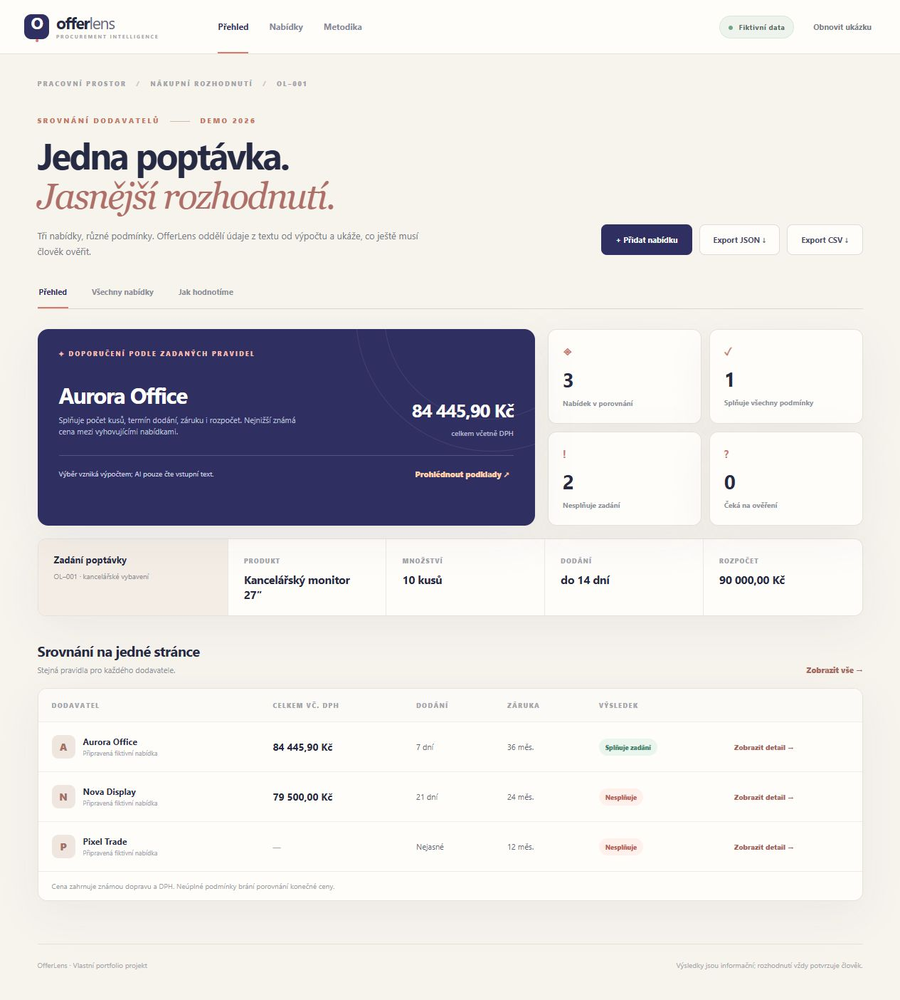

# OfferLens

[Česky](#česky) · [English](#english)

## Česky

**Srovnání dodavatelských nabídek s AI extrakcí, kontrolou člověka a vysvětlitelným výpočtem.**



Projekt ukazuje běžný nákupní problém: nejlevnější nabídka nemusí splnit termín, záruku ani celkový rozpočet. Tři připravené nabídky jsou fiktivní a fungují bez API klíče. Výsledkem ukázky je doporučení **Aurora Office za 84 445,90 Kč včetně DPH**. Levnější Nova Display nesplňuje termín, u Pixel Trade chybí cena dopravy a záruka je příliš krátká.

### Co aplikace umí

- Porovná počet kusů, produkt, dodání, záruku, měnu a rozpočet.
- Počítá ceny v celých haléřích včetně známé dopravy a DPH. Neznámé položky neodhaduje.
- Umožní vložit text nabídky a předvyplnit údaje pomocí OpenAI Responses API se strukturovaným výstupem.
- Ke každému AI údaji vyžaduje doslovný úryvek původního textu. Úryvek **není důkaz správnosti hodnoty**; uživatel ji musí ověřit a výslovně potvrdit shodu produktu.
- Umožní opravit všechna pole, resetovat ukázku, stáhnout porovnání jako JSON nebo CSV i krátký podklad k rozhodnutí v Markdownu a znovu načíst exportované JSON pro stejnou poptávku. Načtené nabídky vyžadují nové lidské potvrzení.
- Rozklikávací panel přímo v aplikaci popisuje použití OpenAI API, oddělený pravidlový výpočet a kontrolu člověkem.
- Při CSV exportu neutralizuje text, který by tabulkový procesor mohl vyhodnotit jako vzorec.

### Použití krok za krokem

Otevřete připravené fiktivní porovnání a projděte, proč nabídka vyhovuje či nevyhovuje. Novou nabídku lze vložit jako text: s místním API klíčem AI navrhne pole a doslovné úryvky, bez klíče lze údaje doplnit ručně. Před zařazením nabídky je potřeba zkontrolovat hodnoty i shodu produktu. Nakonec lze stáhnout výpočet a krátký podklad k rozhodnutí; JSON lze znovu načíst pro stejnou poptávku. Požadavky poptávky jsou v této ukázce pevně nastavené.

### Použité technologie a možné rozšíření

Hotová verze používá **vanilla JavaScript, HTML/CSS, Node.js HTTP server, OpenAI Responses API se strukturovaným výstupem a `node:test`**. AI pouze čte vložený text; pravidla, ceny a pořadí vyhodnocuje samostatný kód. API klíč zůstává na místním serveru. Aplikace neotevírá URL a nestahuje obsah webu. PDF/OCR, více produktových položek, více měn, evidence schvalování a napojení na nákupní systém by byla další práce.

### Možné zavedení ve firmě

Pilot by mohl začít anonymizovanými nabídkami a společně odsouhlasenými kritérii porovnání. Je třeba prověřit, zda lze text nabídek předávat externímu AI poskytovateli, a ponechat schválení nákupčímu. Pro provoz více lidí by se muselo přidat přihlášení, sdílené ukládání, historie změn, stabilní limity nákladů a napojení na schválené zdroje nabídek. Místní demo tyto provozní vlastnosti nemá.

### Spuštění

Vyžaduje Node.js 22 nebo novější. Projekt nemá balíčkové závislosti.

```bash
npm start
```

Otevřete [http://127.0.0.1:4174](http://127.0.0.1:4174). Fiktivní ukázka funguje ihned. Pro AI extrakci vytvořte v kořeni projektu soubor `.env.local` s proměnnou `OPENAI_API_KEY`, podle `.env.example`, nebo nastavte proměnnou v prostředí procesu. Proměnná prostředí má přednost. **Skutečný klíč nikdy nevkládejte do repozitáře.**

```bash
npm test
```

### Jak vzniká výsledek

`ai.mjs` vytěží pole ze vstupního textu. `web/engine.mjs` odmítne AI hodnoty bez odpovídajícího doslovného úryvku, vypočítá celkovou cenu a aplikuje pravidla zadání. `web/app.mjs` ponechá každou novou nabídku k ověření, dokud uživatel nepotvrdí kontrolu údajů a shodu produktu. AI nikdy sama nevybírá dodavatele.

Klíč čte pouze místní `server.mjs`. Server naslouchá na `127.0.0.1`, nepodává soubory mimo `web/`, omezuje velikost vstupu, souběh na dvě extrakce a AI volání na 20 za 24 hodin v rámci běžícího procesu. Text vložený k AI extrakci se odešle OpenAI; připravené nabídky žádné API volání nepotřebují. Tento místní server není určen k veřejnému vystavení bez autentizace a trvalého limitování spotřeby.

### Ověření a hranice

Dvanáct automatizovaných testů ověřuje výpočet, nejisté ceny, kontrolu AI výstupu, bezpečný CSV export, serverové limity a závod souběžných požadavků. Ručně jsem prošel přidání a opravu nabídky, potvrzení údajů, exporty a desktopové i mobilní rozložení. Podrobnosti jsou v [docs/QA.md](docs/QA.md).

První verze pracuje s jednou produktovou položkou v CZK a s vloženým textem. Nečte PDF/OCR, nemá účty ani databázi. Nabídky přidané během relace se drží pouze v paměti prohlížeče; exportované JSON lze znovu načíst pro stejnou poptávku (max. 1 MB a 30 nabídek).

### Technologie

Vanilla JavaScript, Node.js HTTP server, OpenAI Responses API, HTML/CSS a vestavěný `node:test`. Bez frameworku a bez balíčkových závislostí.

## English

**OfferLens compares supplier quotes using AI-assisted extraction, human verification, and explainable calculations.**

The app demonstrates a common purchasing decision: the lowest quoted price may fail delivery, warranty, or budget requirements. Its three prepared offers are fictional and work without an API key. In the sample scenario, OfferLens recommends **Aurora Office at CZK 84,445.90 including VAT**. Cheaper Nova Display misses the delivery deadline; Pixel Trade has unknown shipping cost and an insufficient warranty.

### What it does

- Compares quantity, product match, delivery, warranty, currency, and budget requirements.
- Calculates prices in integer halers, including known shipping and VAT. Unknown costs stay unknown.
- Extracts fields from pasted quote text with the OpenAI Responses API and structured output.
- Requires a verbatim source excerpt for each AI-extracted field. An excerpt **does not prove the value is correct**; the user must verify it and explicitly confirm the product match.
- Lets the user correct every field, reset the sample, export as JSON, CSV or a short Markdown decision brief, and re-import exported JSON for the same request. Imported quotes require fresh review. CSV export neutralizes text that a spreadsheet might interpret as a formula.
- An expandable in-app note explains the API, deterministic calculations, and human review.

### Workflow, stack, and possible adoption

Review the fictional comparison and inspect each result. Paste a new quote for AI-suggested fields and source excerpts when a local API key is configured, or enter the fields manually. Verify all fields and product match before accepting the comparison. Export the decision as JSON, CSV, or Markdown; JSON can be re-imported for the same request. The request requirements are fixed in this demo.

The implemented stack is **vanilla JavaScript, HTML/CSS, a Node.js HTTP server, OpenAI Responses API structured output, and `node:test`**. AI extracts from pasted text; deterministic code calculates totals and checks requirements. The app does not open URLs or download web pages. PDF/OCR, multiple product lines or currencies, approvals, and procurement-system integration are future possibilities.

A company pilot would first use anonymized quotes and agreed evaluation criteria, check whether quote text may be sent to an external AI provider, and retain human purchase approval. Multi-user deployment would require authentication, shared persistence, change history, durable cost limits, and an approved integration path. The local demo does not provide these controls.

### Run locally

Requires Node.js 22 or newer. There are no package dependencies.

```bash
npm start
```

Open [http://127.0.0.1:4174](http://127.0.0.1:4174). The fictional sample works immediately. To enable AI extraction, add `OPENAI_API_KEY` to a local `.env.local` file using `.env.example` as a template, or set it in the process environment. The environment variable takes precedence. **Never commit a real API key.**

```bash
npm test
```

### How the result is produced

`ai.mjs` extracts fields from the pasted text. `web/engine.mjs` rejects AI values without matching verbatim excerpts, calculates the full price, and checks the requirements. `web/app.mjs` keeps each new quote pending until the user confirms both the key details and the product match. AI never selects the supplier on its own.

Only the local `server.mjs` reads the API key. It listens on `127.0.0.1`, serves files only from `web/`, limits request size and concurrent extraction calls, and allows at most 20 AI calls per 24 hours while the process runs. Pasted text is sent to OpenAI for extraction; the prepared sample needs no API call. This local server requires authentication and persistent usage limits before it can be exposed publicly.

### Verification and scope

Twelve automated tests cover pricing, unknown costs, the decision brief, AI output checks, CSV formula protection, server limits, and concurrent requests. Exports and desktop and mobile layouts were checked in a browser. See [QA evidence](docs/QA.md).

This first version handles one product line in CZK and pasted text. It does not read PDF/OCR, provide accounts, or use a database. Quotes added during a session remain in browser memory; exported JSON can be re-imported for the same request (up to 1 MB and 30 quotes).

### Stack

Vanilla JavaScript, a Node.js HTTP server, OpenAI Responses API, HTML/CSS, and the built-in `node:test` runner. No framework or package dependencies.
